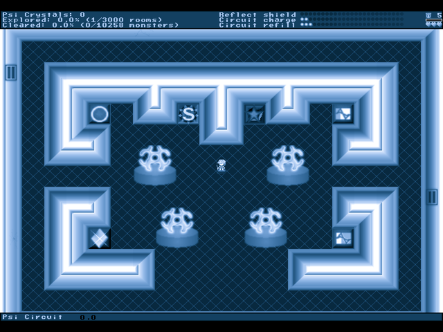
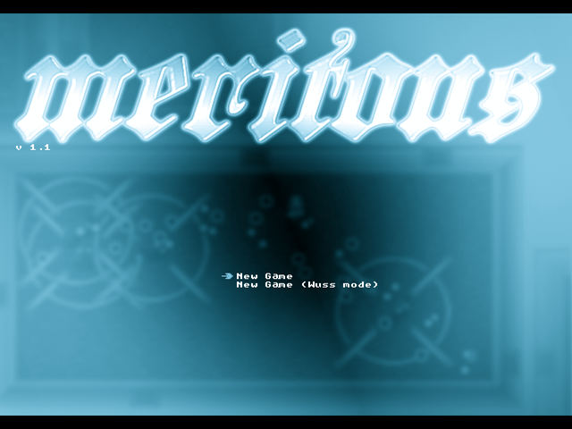
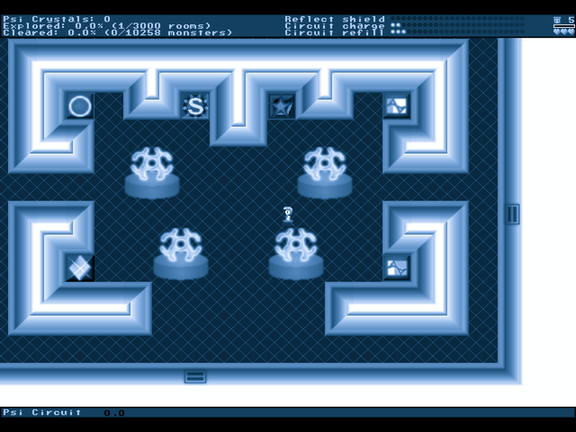

# Meritous

**Lancer-X's action dungeon crawler, on the Amiga.**

  

  
  

Captured from this build running on AmigaOS.

Explore a randomly generated dungeon of 3000 rooms, charge your PSI circuit to blast what lives there, and find the artifacts that will let you face the bosses. Meritous is Lancer-X's freeware action-adventure, here running on the Amiga in 640x480 through acsdl12.

## What you need

A 68040 with an FPU, AmigaOS 3.2 or later, AHI, and an RTG card (on AGA only part of the 640x480 picture shows for now).

Everything the game needs is in its `dat` drawer, which comes with it.

## Controls

| Key | Does |
|---|---|
| Arrows | Move, push through doors |
| Space | Charge the PSI circuit |
| Return | Use a trigger tile, read dialogue |
| Tab | Map |
| H | Help |
| P | Pause |
| Esc | Exit |

## What works

- Title, new game, the dungeon, combat and saves on RTG
- Sound effects and the MOD tunes through AHI

## Not in this build yet

- The XM and S3M tunes are not played, so the title and some rooms are quiet
- AGA shows only the top-left part of the picture

## Building

The Amiga build, its make file and what was changed for the 68k are described in [AMIGA_PORT.md](AMIGA_PORT.md).

## Credits and licence

Meritous by Lancer-X/Asceai ([upstream](https://github.com/bart9h/meritous)). Licence: GPL 3.

Amiga port by The AmiCradle Team.
